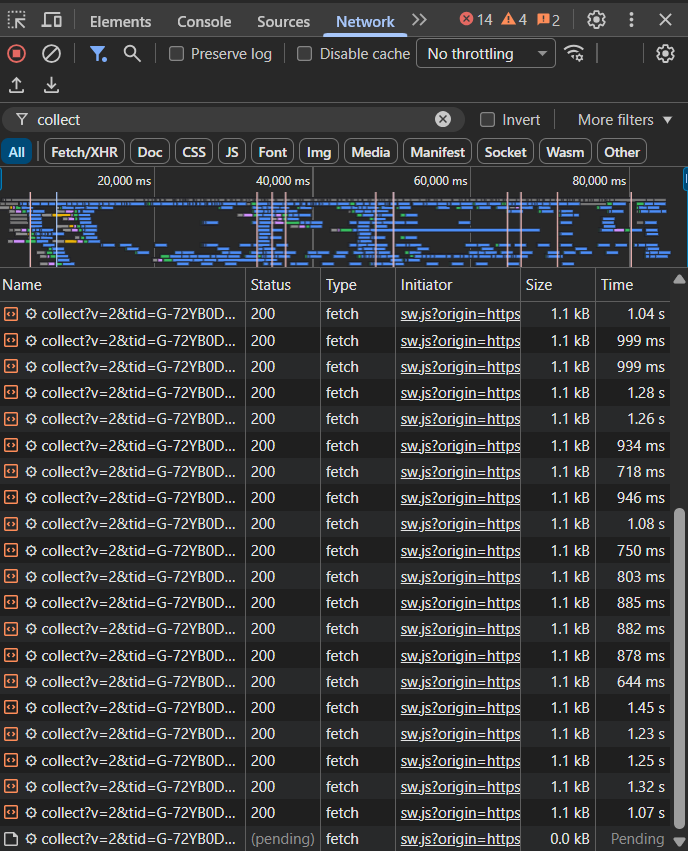
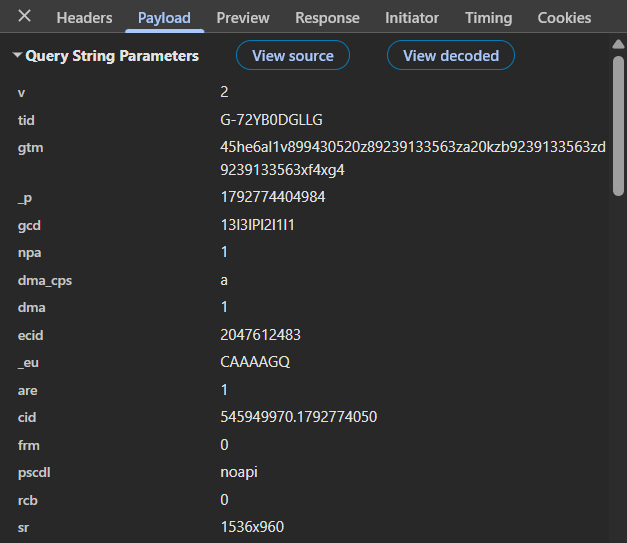

# Домашняя работа № 1 · Путь данных от ссылки до заявки

**Дисциплина:** ОП.03 «Информационные технологии»

| Поле | Значение |
|---|---|
| Фамилия, имя, отчество | Булаева Ева Игоревна |
| Группа | РПО/1, 2 курс |
| Номер работы | 1 |
| Тема работы | Цифровая воронка: путь данных от ссылки до заявки |
| Дата сдачи | 11.09.2026 |

---

## Задание

1. Открыть сайт, панель разработчика (F12) → **Network**, в фильтре `collect`,
   галочка **Preserve log**.
2. Сделать три действия: обновить страницу, прокрутить до низа, нажать
   на товар. Записать, какие события ушли — параметр `en` на вкладке **Payload**.
3. Описать путь пользователя от ссылки до заявки, пять шагов.
4. Найти одно место на этом пути, где данные могут потеряться.
5. Приложить скриншоты `screens/01-network.png` и `screens/02-payload.png`.

Сайт: https://shop.merch.google/, запасные — https://habr.com/ru/,
https://www.smashingmagazine.com/, https://css-tricks.com/. Открывать
в Chrome или Edge с выключенным блокировщиком рекламы.

Срок — до начала занятия 2. Работа сдаётся коммитом в `main`.

---

## 1. Какой сайт смотрел

| Поле | Значение |
|---|---|
| Название сайта | Л'Этуаль |
| Адрес | https://www.letu.ru/?utm_source=yandex&utm_medium=cpc&utm_campaign=le_yd_spb_s_search_brand&utm_term=---autotargeting&srcid=le_yd_spb_s_search_brand&utm_content=astat:53487801828%7Cret:53487801828%7Ckor:0%7Cdsa:53487801828%7Ccid:115308452%7Cgid:5506509520%7Caid:1914276300816843469%7Cpt:premium%7Cpos:1%7Cst:search%7Csrc:none%7Cdvc:desktop%7Creg:2%7Cadp:no%7Capt:none%7Clink:main%7Coctober_presents&etext=2202.2h0LHKoXINSFpcCQ-1gFXd0l6HmHKsD9XxSc_uIzif5nZHhranJiaXdiYmhnY215.7630c280d19804259f39ae61ef2bb22752e7c74d&yclid=3447010488052088831 |
| Откуда сайт | свой |

## 2. Три действия и что отправил счётчик

Панель Network, фильтр `collect`, галочка Preserve log. Название события
лежит в параметре `en` на вкладке Payload.

В первой строке стоит пример. **Удалите его** и впишите свои три.

| № | Что я сделал на сайте | Название события (`en`) | Что ещё было в Payload |
|---|---|---|---|
| — | *пример: открыл главную страницу* | *`page_view`* | *`dl`, в нём адрес страницы* |
| 1 | Зашла на товар | view_item_list |  |
| 2 | Зашла на короткое видео | video_start |  |
| 3 | Добавила товар в корзину | add_to_cart |  |

## Скриншоты:

### Network

---

### Payload 

## 3. Путь пользователя: 5 шагов

От ссылки до заявки, своими словами. Панель для этого не нужна: это рассказ
о том, как человек доходит до кнопки «Отправить». В правом столбце стоит
пример, в левом вы пишете свой вариант.

| № | Мой шаг | Пример |
|---|---|---|
| 1 | Человек зашел на товар | *человек увидел ссылку в сообществе и нажал на неё* |
| 2 | Открылась карточка товара | *открылась главная страница сайта* |
| 3 | Он нажал кнопку "Добавить в корзину" | *он прокрутил до формы записи* |
| 4 | Открыл вкладку "Корзина" | *начал заполнять: имя и телефон* |
| 5 | Пролистал вниз и нажал кнопку "Перейти к оплате" | *нажал «Отправить», заявка ушла менеджеру* |
| 6 | Пролистал вниз и нажал кнопку "Перейти к оплате" | |
| 7 | Ввел свои данные, нажал кнопку "Оплатить", заявка заказа доставлена в магазин | |

## 4. Где данные могут потеряться

В первой строке стоит пример, **удалите его**. Строку 1 заполняют все,
строку 2 заполняйте по желанию.

| № | На каком шаге | Что может потеряться |
|---|---|---|
| 1 | Заполнение заявки | клиент закроет вкладку до нажатия «Отправить», данные не сохранятся |

## 5. Использование ИИ

| Вопрос | Ответ |
|---|---|
| Что сделал сам | все |
| Что спросил у модели | как сделать правильно скриншот, какой вкладки |

