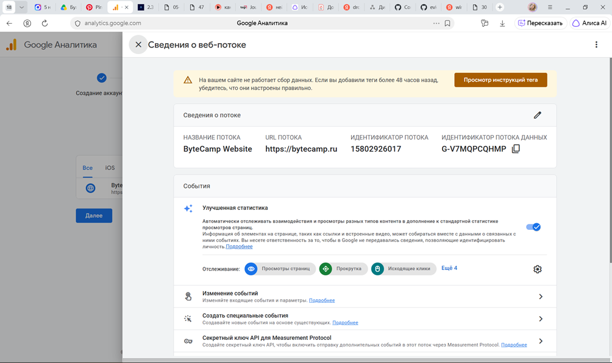
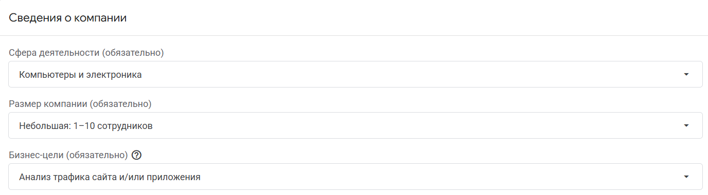
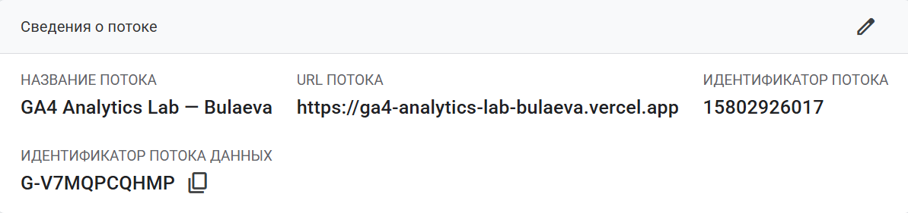

# Домашняя работа № 2 · Где бизнес теряет клиентов

**Дисциплина:** ОП.03 «Информационные технологии»

| Поле | Значение |
|---|---|
| Фамилия, имя, отчество | Булаева Ева Игоревна |
| Группа | РПО/1, 2 курс |
| Номер работы | 2 |
| Тема работы | Анализ воронки цифрового продукта и структура Google Analytics 4 |
| Дата сдачи | 18.09.2026 |

---

# Часть 1. Исследование воронки

## 1.1. Объект исследования

| Поле | Значение |
|---|---|
| Компания, сервис или отрасль | Золотое яблоко |
| Адрес сайта или приложения | https://goldapple.ru |
| Целевое действие | Покупка товара |
| Почему выбран этот объект | Любимый магазин |

## 1.2. Воронка

| Название этапа | Описание | Переход дальше | Метрика |
| :--- | :--- | :--- | :--- |
| *Привлечение/Реклама* | Контакт пользователя с брендом через канал в Telegram, VK-сообщество, рекламу известных личностей и др. | Переход на сайт через клик по рекламе. | **CTR** — стоимость клика (CPC), доля каналов в трафике |
| *Вход на сайт/приложение* | Открытие главной страницы на сайте goldapple.ru или запуск приложения | Просмотр хотя бы 1-ой страницы каталога | **Bounce Rate** — сессии, уникальные посетители |
| *Просмотр карточки товара* | Пользователь открывает карточку товара | Добавление товара в корзину или избранное | **CR карточка** — доля добавлений в корзину от просмотров, время на странице |
| *Добавление в корзину* | Товар помещен в корзину и пользователь переходит к оформлению заказа | Переход на страницу оформления заказа | **CR корзина** — доля переход к оформлению от созданных корзин |
| *Оформление заказа* | Заполнение адреса доставки, способ оплаты | Оплата заказа | **CR чекаут** — время оформления |
| *Оплата и получение* | Заказ оплачен, собран и доставлен курьером/самовывоз из магазина или пункта выдачи | Подтверждение получения заказа | **CR оплата** — процент возвратов, оценка заказа |

## 1.3. Источники

Не менее пяти. Каждый разбирается по пяти пунктам.

### Источник 1

| Поле | Значение |
|---|---|
| Название материала | Исследование бьюти-ритейлеров от МТС AdTech |
| Автор или организация | МТС AdTech |
| Дата публикации | Август 2026 |
| Прямая ссылка | https://ria.ru/20260824/mts-2112756672.html |

**Выписка из материала** (ключевая мысль, цифра, наблюдение, результат):

> Мобильное приложение «Золотого Яблока» является главным каналом продаж: через него идет около 90% онлайн-выручки. Наблюдается рост аудитории, среднего чека и частоты заказов в приложении.

**Что подтверждает и как связано с моей воронкой** (своими словами):

> Источник подтверждает, что приложение — ключевой драйвер продаж. Это обосновывает важность первого этапа воронки (привлечение), показывая, что усилия по привлечению трафика нужно направлять в первую очередь на скачивание и открытие мобильного приложения, а не на сайт.

**Цифры из источника и этап воронки, к которому относятся:**

> 90% онлайн-выручки проходит через приложение.
> **Этап воронки:** Привлечение / Вход на сайт (приложение).

### Источник 2

| Поле | Значение |
|---|---|
| Название материала | «Дозрели: сеть Золотое яблоко обогнала Подружку» |
| Автор или организация | Forbes |
| Дата публикации | 2025 |
| Прямая ссылка | https://www.forbes.ru/biznes/534066-dozreli-set-zolotoe-abloko-obognala-podruzku-letual-i-riv-gos |

**Выписка из материала** (ключевая мысль, цифра, наблюдение, результат):

> Сеть «Золотое яблоко» обогнала конкурентов («Подружку», «Летуаль» и «Рив Гош»). Ключевые показатели: значительный объем выручки, доля онлайн-продаж составляет 60% в 2025 году, а также высокие темпы роста компании.

**Что подтверждает и как связано с моей воронкой** (своими словами):

> Статья подтверждает масштаб бизнеса и высокую долю онлайн-продаж. Это обосновывает актуальность анализа воронки: при таких объемах выручки даже небольшие потери конверсии на каждом этапе (например, на этапе оформления заказа или оплаты) оборачиваются огромными финансовыми потерями в абсолютных значениях.

**Цифры из источника и этап воронки, к которому относятся:**

> Доля онлайн-продаж — 60% (2025 год).
> **Этап воронки:** Вход на сайт/приложение, Оформление заказа, Оплата и получение (влияет на оценку потерь на всех этапах онлайн-воронки).

### Источник 3

| Поле | Значение |
|---|---|
| Название материала | Аналитика трафика goldapple.ru |
| Автор или организация | Similarweb |
| Дата публикации | Август 2026 |
| Прямая ссылка | https://www.similarweb.com/ru/website/goldapple.ru/ |

**Выписка из материала** (ключевая мысль, цифра, наблюдение, результат):

> Данные о поведении пользователей на сайте: bounce rate (показатель отказов) составляет 39%, глубина просмотра — 5,76 страницы, среднее время сессии — 5 минут 33 секунды. Также представлены данные по источникам трафика и демографии.

**Что подтверждает и как связано с моей воронкой** (своими словами):

> Источник позволяет оценить качество входящего трафика и поведение пользователей внутри сайта. Это напрямую связано с этапом «Вход на сайт» (по bounce rate видно, что уходит сразу после первого экрана) и этапом «Просмотр карточки товара» (глубина просмотра и время сессии показывают, насколько активно люди изучают ассортимент перед добавлением в корзину).

**Цифры из источника и этап воронки, к которому относятся:**

> Bounce rate — 39%, глубина просмотра — 5,76 страницы, время сессии — 5 мин 33 сек.
> **Этап воронки:** Вход на сайт/приложение, Просмотр карточки товара.

### Источник 4

| Поле | Значение |
|---|---|
| Название материала | Почему покупатели бросают корзины в интернет-магазинах: исследование RetailCRM и ЮKassa |
| Автор или организация | RetailCRM и ЮKassa |
| Дата публикации | 9 апреля 2024 (04.09.2024) |
| Прямая ссылка | https://www.retailcrm.ru/blog/posts/issledovanie-o-broshennoy-korzine |

**Выписка из материала** (ключевая мысль, цифра, наблюдение, результат):

> 30% покупателей используют корзину как список желаний. 29% бросают корзину в ожидании зарплаты, 18% — если итоговая стоимость оказывается выше ожидаемой. Технические причины: 8% не завершают заказ из-за необходимости регистрации, 6% — из-за сомнений в безопасности оплаты. 26% покупателей вернутся и оформят заказ, если предложить скидку.

**Что подтверждает и как связано с моей воронкой** (своими словами):

> Исследование напрямую подтверждает, что этапы «Корзина» и «Оформление заказа» являются критическими точками потерь в воронке. Основные причины отказа (финансовые ожидания, сложность интерфейса, необходимость регистрации) помогают обосновать гипотезы о необходимости упрощения процесса чекаута, внедрения прозрачных условий доставки и использования триггерных скидок для возврата пользователей.

**Цифры из источника и этап воронки, к которому относятся:**

> 30% используют корзину как вишлист; 29% ждут зарплату; 8% уходят из-за регистрации; 26% возвращаются за скидку.
> **Этап воронки:** Добавление в корзину, Оформление заказа.

### Источник 5

| Поле | Значение |
|---|---|
| Название материала | Как «Золотое яблоко» говорит с зумерами: обзор коммуникационной стратегии |
| Автор или организация | HSE Design (Школа дизайна НИУ ВШЭ) |
| Дата публикации | 29.12.2025 |
| Прямая ссылка | https://hsedesign.ru/project/kak-reklamnye-kampanii-zolotogo-yabloka-s-4d0959a6f80d4f2390f54ea21b0ca53d |

**Выписка из материала** (ключевая мысль, цифра, наблюдение, результат):

> Бренд активно ведет ВКонтакте, Telegram и Дзен, но ключевым каналом является Telegram (более 840 тысяч подписчиков на ноябрь 2025). Контент-стратегия включает посты с акциями и промокодами, а также развлекательные форматы (мемы, шутки). Коммуникация построена на дружелюбном и неформальном Tone of Voice с обращением на «ты», что создает эффект общения с другом. Лаймовый цвет бренда ассоциируют с компанией 56% россиян (по данным ВЦИОМ).

**Что подтверждает и как связано с моей воронкой** (своими словами):

> Источник подтверждает структуру первого этапа воронки — привлечения. Он показывает, что основными каналами трафика являются Telegram, VK и Дзен, а работа с поколением Z строится через понятный им язык (мемы, неформальный тон). Это помогает понять, какие источники наиболее значимы для первичного контакта с аудиторией и как бренд стимулирует переход по ссылкам (через акции и промокоды).

**Цифры из источника и этап воронки, к которому относятся:**

> 840 000+ подписчиков в Telegram (ноябрь 2025); 56% ассоциация с лаймовым цветом.
> **Этап воронки:** Привлечение/Реклама (первичный контакт и переход на сайт/в приложение).

### Источник 6

| Поле | Значение |
|---|---|
| Название материала | Маркетинг «Золотого яблока»: как небольшой магазин вырос в федерального лидера бьюти-рынка |
| Автор или организация | Unisender (автор: Марья Уросова) |
| Дата публикации | 23.04.2026 |
| Прямая ссылка | https://www.unisender.com/ru/blog/kak-ustroeno-zolotoe-yabloko/ |

**Выписка из материала** (ключевая мысль, цифра, наблюдение, результат):

> Онлайн-продажи дают компании больше 50% выручки. Приложение построено вокруг визуального выбора (крупные карточки, как журнальные развороты), понимает опечатки и включает игровые механики («пасхальные яйца» за 10 000 бонусов, «бьюти-тамагочи»). Бренд активно использует email-рассылки с промокодами и советами, а также работает с UGC и блогерами, превращая клиентов в микроинфлюенсеров.

**Что подтверждает и как связано с моей воронкой** (своими словами):

> Источник подтверждает, что приложение и онлайн-каналы — ключевые точки взаимодействия с аудиторией. Это связывает этапы от «Привлечения» (через email, соцсети, блогеров) до «Добавления в корзину»: игровые механики и бонусы удерживают пользователя внутри приложения, стимулируют возвращаться и совершать покупки. Также статья показывает, как программа лояльности и персональные предложения влияют на решение о покупке.

**Цифры из источника и этап воронки, к которому относятся:**

> Более 50% выручки — онлайн-продажи; 10 000 бонусов за найденное «пасхальное яйцо».
> **Этап воронки:** Привлечение/Реклама, Вход на сайт/приложение, Просмотр карточки товара, Добавление в корзину.

## 1.4. Реальные кейсы

Не менее двух, российские компании или российский рынок. Каждый разбирается по семи
пунктам. Если показатели не опубликованы, пишется: «точные показатели
в открытом источнике не приведены».

### Кейс 1

| № | Пункт | Ответ |
|---|---|---|
| 1 | Компания, продукт или рынок | E-commerce платформа (аналитический разбор new lvl.pro). Рынок — российский онлайн-ритейл. |
| 2 | Как выглядела воронка или её проблемный участок | Фокус на участке: «добавление в корзину → оформление заказа → оплата». Конверсия «корзина → заказ» упала с 60% до 45%. Декомпозиция показала, что сильнее всего просел переход «оформление → оплата» (с 89% до 69%). |
| 3 | В чём заключалась проблема | Техническая ошибка: баг в новой форме ввода карты на mobile web. При этом другие каналы оплаты (СБП, рассрочка), а также десктоп и приложение работали стабильно. |
| 4 | Какие данные или наблюдения подтвердили проблему | Падение конверсии на 15 процентных пунктов. Сегментирование по устройствам и способам оплаты: на mobile web при оплате картой конверсия рухнула с 86% до 35%. Стабильность остальных сегментов (СБП, рассрочка, приложение, десктоп). |
| 5 | Что изменили или протестировали | В кейсе не указано, какие именно правки внедрили, но выявленная причина (баг формы ввода карты) предполагает исправление кода платёжной формы на мобильной версии сайта. |
| 6 | Как изменился результат | Показатели после исправления в материале не приведены. Однако локализация проблемы даёт чёткое понимание, что устранение бага должно вернуть конверсию к исходному уровню. |
| 7 | Переносим ли подход на мой объект | Можно. У «Золотого яблока» пользователи массово жалуются на проблемы с оплатой картой, ошибки чекаута и пропажу подарочных карт (отзывы в RuStore, Otzovik, VK). Подход с декомпозицией воронки по сегментам (устройство, способ оплаты, версия приложения) поможет точно локализовать технические сбои. Приоритет — мониторинг ошибок на этапе оплаты, crash-логи, доля отказов по типам платежей и A/B-тесты исправленных форм. |

**Ссылка на источник кейса:**

> [https://lvl.pro/]

### Кейс 2

| № | Пункт | Ответ |
|---|---|---|
| 1 | Компания, продукт или рынок | «Золотое Яблоко», собственная торговая марка (СТМ) FOR ME, продукт — сухой шампунь. Рынок — российский бьюти-ритейл и маркетплейсы. |
| 2 | Как выглядела воронка или её проблемный участок | Верхняя часть воронки: «показ → контакт → переход → покупка». Фокус на влиянии инфлюенс-маркетинга и сопутствующих факторов на конверсию. |
| 3 | В чём заключалась проблема | Инфлюенс-маркетинг эффективно поднимает видимость и частоту контактов (верхняя часть воронки), но не гарантирует покупку. Конверсия в покупку остаётся низкой и зависит от дополнительных факторов: промо-механик, сезонности, наличия товара на складе. |
| 4 | Какие данные или наблюдения подтвердили проблему | По данным исследования Кузовковой А. О. (журнал «Маркетинг и маркетинговые исследования», 2026) за год (01.12.2024–01.12.2025): 495 726 показов карточки товара на маркетплейсах; 1 010 продаж; конверсия в покупку — 0,204%. |
| 5 | Что изменили или протестировали | В рамках описанного исследования не указаны конкретные изменения со стороны компании. Однако выводы позволяют рекомендовать усиление промо-механик и контроль остатков как способы повысить конверсию после инфлюенс-трафика. |
| 6 | Как изменился результат | В материале нет данных об изменении показателей после каких-либо действий. |
| 7 | Переносим ли подход на мой объект | Да. Для «Золотого Яблока» это подтверждает, что инфлюенс-продвижение нужно увязывать с промо-акциями и управлением остатками. Чтобы не терять трафик от блогеров, важно: синхронизировать промо с пиками охвата; контролировать наличие товара на складах; отслеживать конверсию по UTM-меткам и отдельным кампаниям. Это позволит точнее оценивать вклад инфлюенсеров и повышать отдачу от маркетинга. |

**Ссылка на источник кейса:**

> [Кузовкова А.О. Влияние инфлюенс-маркетинга на ключевые показатели продаж (на примере продукта сухой шампунь «FOR ME» бренда «Золотое Яблоко») // Маркетинг и маркетинговые исследования. 2026. Т. 31. № 1. С. 119–132.](https://1economic.ru/lib/124537)

### Кейс 3 

| № | Пункт | Ответ |
|---|---|---|
| 1 | Компания, продукт или рынок | Beauty e-commerce в целом (данные Haut.AI), пример внедрения в сегменте — «Золотое Яблоко» с 3D-конфигураторами и видеообложками. Рынок — онлайн-продажи косметики и средств ухода. |
| 2 | Как выглядела воронка или её проблемный участок | Участок: «просмотр карточки → консультация → добавление в корзину → покупка». Проблема: отсутствие оперативной консультации приводит к уходу 70% пользователей без покупки. |
| 3 | В чём заключалась проблема | Покупатели не получают своевременной помощи при выборе бьюти-продуктов (тон, уход и т.п.), из-за чего отказываются от покупки. |
| 4 | Какие данные или наблюдения подтвердили проблему | По данным Haut.AI, AI-анализ кожи повышает конверсию в 2 раза и увеличивает средний чек на 31% [citation:8]. 70% покупателей уходят без покупки, если не могут быстро получить консультацию. «Золотое Яблоко» уже использует 3D-конфигураторы и видеообложки: вовлечённость +25%, конверсия +15%. |
| 5 | Что изменили или протестировали | Внедрение AI-анализа кожи, 3D-конфигураторов, видеообложек. В кейсе нет описания отдельного A/B-теста, но приведены агрегированные эффекты технологий. |
| 6 | Как изменился результат | Вовлечённость +25% за счёт 3D-конфигураторов и видео. Конверсия +15% на тех же элементах. В целом по рынку AI-анализ кожи даёт двукратный рост конверсии и +31% к среднему чеку [citation:8]. |
| 7 | Переносим ли подход на мой объект | Можно, и это особенно актуально для «Золотого Яблока». Учитывая, что выбор бьюти-товаров часто требует подбора, внедрение AI-ассистента (подбор по типу кожи, оттенку и т.д.) логично масштабировать. Уже работающие 3D-инструменты показывают, что аудитория готова к интерактиву. |

**Ссылка на источник кейса:**

> [TP Magazine, 2026 — материал не найден в открытом доступе. Ближайшее подтверждение данных Haut.AI: пост CEO Haut.AI Анастасии Георгиевской в LinkedIn (2025), где указаны 2x конверсия и +31% AOV для AI-анализа кожи.](https://www.linkedin.com/posts/georgievskaya_ai-hautai-olay-activity-7382039835412168704-R41o) [citation:8]

## 1.5. Причины потери пользователей

Не менее трёх. Каждая опирается на найденные материалы.

| № | Этап воронки | Причина потери | Какой источник это подтверждает |
|---|---|---|---|
| 1 | Оплата и получение | Техническая нестабильность приложения и ошибки оплаты: приложение не открывается, выдает ошибку, зависает или не позволяет оплатить заказ картой. | Отзывы в RuStore, Otzovik, VK; данные Baymard Institute (18% отказов на этапе оплаты). |
| 2 | Оформление заказа | Скрытые доплаты и непрозрачность стоимости: внезапное обнаружение платной доставки или дополнительных сборов на последнем шаге. | Исследование i-Media (2026); данные RetailCRM (доля брошенных корзин 85-88%); условия самого «Золотого Яблока» (плата за разделение заказа). |
| 3 | Просмотр карточки / Консультация | Долгое время ответа поддержки и недостаток консультаций: невозможность быстро получить помощь при выборе товара. | Пост в сообществе «Золотого Яблока» ВКонтакте; данные TP Magazine (70% отказов без консультации). |

## 1.6. Гипотезы улучшения

## 1.6. Гипотезы улучшения

| № | Этап | Гипотеза | Какие данные нужно собрать | Как проверить, сработало |
|---|---|---|---|---|
| 1 | Оформление заказа | Внедрение гостевого оформления заказа и упрощение чекаута (сокращение количества полей и шагов) снизит потери на этапе оформления на 5–10%. | Конверсия в успешный заказ (CR); доля брошенных корзин (особенно на шаге ввода номера телефона); количество ошибок валидации; время прохождения чекаута. | A/B-тест: группа А — текущий чекаут, группа В — упрощенный (гостевой) чекаут. Сравнение конверсии из корзины в заказ и среднего времени оформления. |
| 2 | Корзина / Оформление заказа | Прозрачное отображение стоимости доставки и доп. сборов на ранних этапах (в корзине и карточке товара) снизит долю брошенных корзин на 3–5%. | Доля брошенных корзин с суммой < 1 500 ₽ (порог бесплатной доставки); количество обращений в поддержку по вопросу стоимости доставки; тепловые карты (heatmap) скролла страницы оформления. | A/B-тест: группа А — показ стоимости доставки только на финальном шаге, группа В — показ в корзине. Метрики: конверсия «корзина → чекаут» и «чекаут → оплата». |
| 3 | Просмотр карточки товара | Внедрение AI-ассистента для подбора косметики (24/7, без ожидания ответа консультанта) повысит конверсию из карточки в корзину на 10–20% и средний чек на 15–30%. | Показы и клики по рекомендациям AI; количество диалогов с ассистентом; CR в корзину среди пользователей, использовавших ассистента, и без него. | A/B-тест: группа А — стандартная карточка, группа В — карточка с AI-ассистентом. Метрики: конверсия «карточка → корзина», средний чек, доля возвратов. Также сбор NPS/CSAT по работе ассистента. |

---

# Часть 2. Google Analytics 4

## 2.1. Пройденные шаги

| № | Шаг | Выполнено |
|---|---|---|
| 1 | Вход в Google Analytics под своим аккаунтом | да |
| 2 | Создан Analytics Account | да |
| 3 | Создан Property | да |
| 4 | Выбраны часовой пояс, валюта и общие сведения | да |
| 5 | Выбраны бизнес-цели | да |
| 6 | Создан ресурс | да |
| 7 | Создан Web Data Stream | да |
| 8 | Проверены Website URL, Stream name, Enhanced Measurement | да |
| 9 | Поток создан | да |
| 10 | Найден Measurement ID | да |

## 2.2. Что получилось

| Поле | Значение |
|---|---|
| Analytics Account | GA4 Analytics Lab — Bulaeva |
| Property | College Landing |
| Reporting time zone | (GMT+03:00) Москва |
| Currency | Российский рубль |
| Выбранные бизнес-цели | Анализ трафика сайта и предложений |
| Stream name | GA4 Analytics Lab — Bulaeva |
| Website URL | https://ga4-analytics-lab-bulaeva.vercel.app |
| Stream ID (числовой) | V7MQPCQHMP |
| Measurement ID (`G-…`) | G-V7MQPCQHMP |
| Enhanced Measurement | включено |

Stream ID и Measurement ID — это разные идентификаторы. На сайт в задании 3
ставится второй, вида `G-XXXXXXXXXX`.

## 2.2. Скриншоты

---

## Использование ИИ

Источники вы ищете, читаете и проверяете сами, настройку проходите тоже
сами. ИИ допускается для поиска идей, структурирования и проверки
формулировок, но источником он не считается.

| Вопрос | Ответ |
|---|---|
| Что сделано самостоятельно | все |
| Что спрошено у модели | помощь в поиске инфы, структурирование для формата .md |

