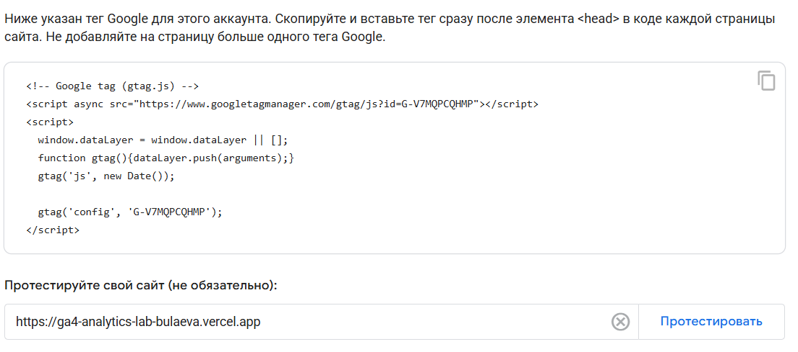
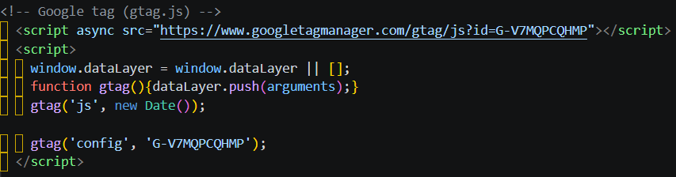
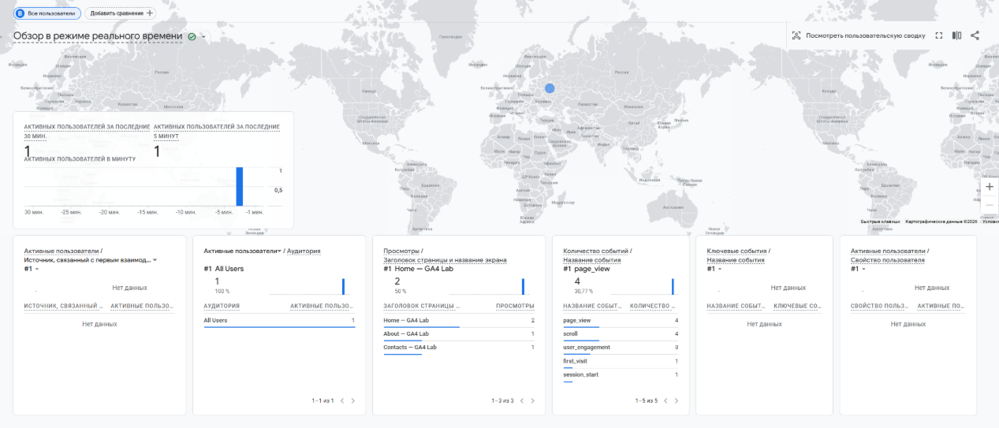
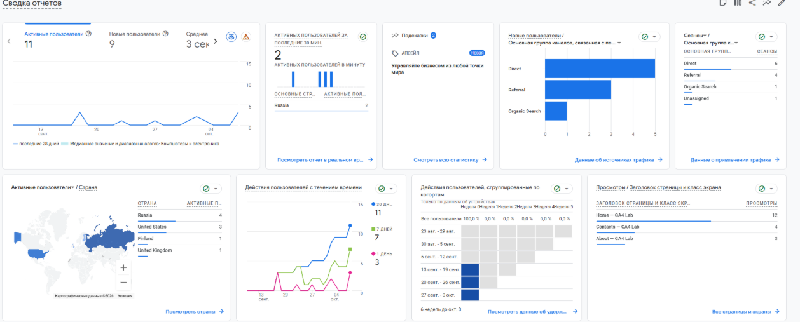

# Домашняя работа № 3 · Тег на сайте, источник и отчёты GA4

**Дисциплина:** ОП.03 «Информационные технологии»

| Поле | Значение |
|---|---|
| Фамилия, имя, отчество | Булаева Ева Игоревна |
| Группа | РПО/1, 2 курс |
| Номер работы | 3 |
| Тема работы | Установка Google Tag, источник перехода и отчёты GA4 |
| Дата сдачи | 25.09.2026 |

---

## 1. Мой сайт и мой ресурс

| Поле | Значение |
|---|---|
| Адрес репозитория сайта | https://github.com/evkkiis/ga4-analytics-lab-bulaeva |
| Публичный адрес сайта |  |
| Статус публикации | READY |
| Analytics Account | GA4 Analytics Lab — Bulaeva |
| Property | College Landing |
| Stream name | GA4 Analytics Lab — Bulaeva |
| Website URL в потоке | https://ga4-analytics-lab-bulaeva.vercel.app |
| Measurement ID (`G-…`) | G-V7MQPCQHMP |
| Страницы с тегом | Index.html |

Тег ставится на каждую страницу по одному разу: две копии дают двойные
события.

## 2. Тег установлен

**Результат проверки из инструкции тега:**

>





## 3. События доходят до аналитики

| Поле | Значение |
|---|---|
| Дата и время проверки | 23.10.2026 22:18 |
| Какие страницы открывали | /index.html, /about.html |
| Какие события появились в Realtime | Просмотр страницы |
| Число активных пользователей в момент проверки | 1 |



## 4. Источник перехода определился

Ссылка собирается с метками `utm_source`, `utm_medium`, `utm_campaign`
и открывается на своём сайте.

**Ссылка целиком:**

```
https://ga4-analytics-lab-bulaeva.vercel.app
```

| Поле | Значение |
|---|---|
| Где в GA4 виден источник | Отчеты -> Источники трафика -> Привлечение трафика |
| Какое значение источника показал GA4 | ВК |
| Совпадает с `utm_source` из ссылки | да |

Скриншот: вставьте строку ``

Источник и кампания из UTM в отчёте Realtime не показываются: эти измерения
вычисляются при обработке данных. Если в Realtime источника нет, смотрите
отчёт по источникам трафика в разделе «Отчёты».

## 5. Статистика на странице «Отчёты»

## 5. Статистика на странице «Отчёты»

| Показатель | Значение | Период |
| :--- | :--- | :--- |
| Пользователи | 11 | последние 28 дней |
| Сеансы | 12 | последние 28 дней |
| События | 59 | последние 28 дней |
| Самое частое событие | page_view (19) | последние 28 дней |




**Что видно по этим числам** (2–3 предложения):

> За отчетный период ресурс посетили 11 пользователей, совершивших 12 сеансов. Всего система зарегистрировала 59 событий, среди которых преобладает page_view (19 раз), что подтверждает активный просмотр страниц сайта посетителями. Основной поток посещений был получен за счет прямых заходов (Direct) и переходов по ссылкам (Referral).


