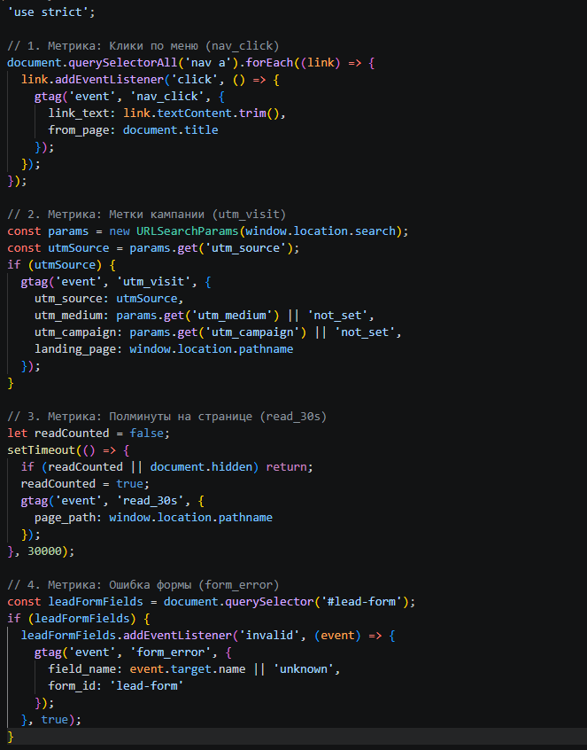
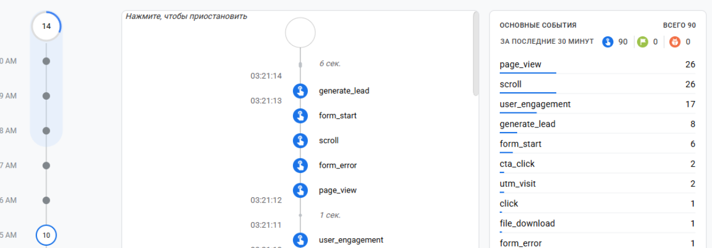
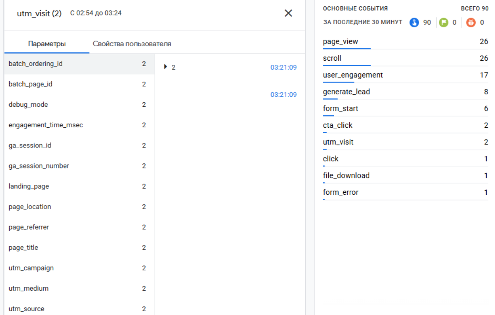
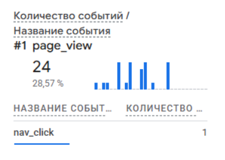

# Домашняя работа № 4 · Свои события и параметры в GA4

**Дисциплина:** ОП.03 «Информационные технологии»

| Поле | Значение |
|---|---|
| Фамилия, имя, отчество | Булаева Ева Игоревна |
| Группа | РПО/1, 2 курс |
| Номер работы | 4 |
| Тема работы | Свои события и параметры: четыре метрики на сайте |
| Дата сдачи | 8.10.2026 |

---

## 1. Мой сайт и мой ресурс

| Поле | Значение |
|---|---|
| Публичный адрес сайта | https://ga4-analytics-lab-bulaeva.vercel.app |
| Measurement ID (`G-…`) | G-V7MQPCQHMP |
| Статус публикации | READY |
| Страницы, где подключён `js/metrics.js` | index.html , about.html, contacts.html |

Файл подключается после основного скрипта и на каждой странице по одному
разу: два подключения дают двойные события.

## 2. Какие метрики добавлены

| Событие | Что измеряет | Что делали, чтобы оно сработало |
|---|---|---|
| `nav_click` | клики по пунктам меню | Нажала на ссылку в навигационном меню сайта. |
| `utm_visit` | метки кампании из адреса | 	Открыла сайт по ссылке с добавленными UTM-метками. |
| `read_30s` | полминуты на странице | Открыла страницу и подождал 30 секунд, не сворачивая вкладку. |
| `form_error` | форма не прошла проверку браузера | Попыталась отправить пустую форму с обязательными полями. |



## 3. События в DebugView

| Поле | Значение |
|---|---|
| Дата и время проверки | 23.10.2026 22:37 |
| Как подключали отладку | Tag Assistant |
| Какие из четырёх событий пришли | nav_click, utm_visit, read_30s, form_error |
| Какие не пришли и почему | Все четыре события успешно дошли до отладки. |



## 4. Параметры события `utm_visit`

**Ссылка, по которой открывали сайт:**

```
https://ga4-analytics-lab-bulaeva.vercel.app
```

| Параметр | Значение в ссылке | Значение в GA4 |
| :--- | :--- | :--- |
| `utm_source` | telegram | telegram |
| `utm_medium` | social | social |
| `utm_campaign`| ga4_lab | ga4_lab |
| `landing_page`| — | / |




## 5. Событие вне отладки

| Поле | Значение |
|---|---|
| Где проверяли | Realtime |
| Какое событие искали | nav_click |
| Сколько срабатываний показал экран | 1 |
| Период (для отчёта) | последние 30мин |



## 6. Что эти метрики показывают про сайт

Два-три предложения: что вы узнали о поведении посетителей из четырёх
новых событий. Например, по каким пунктам меню ходят чаще, доходит ли
кто-то до получаса чтения, спотыкается ли форма.

>Новые метрики позволяют детально отслеживать поведение пользователей: переходы по меню (nav_click) показывают интерес к разделам, а UTM-метки (utm_visit) фиксируют рекламный трафик. Таймер read_30s помогает оценить вовлеченность и реальное чтение страниц, а form_error подсвечивает проблемные места при заполнении формы.


